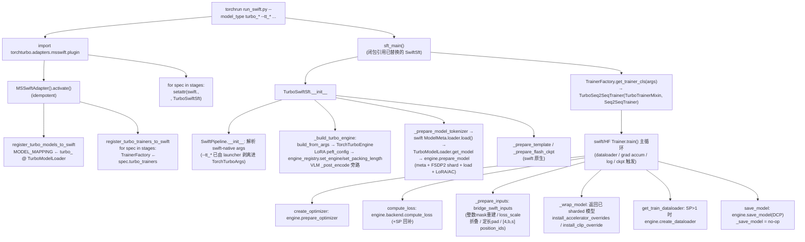

# torchturbo × ms-swift 适配器设计书

- 作者：奚云
- 日期：2026-07-23
- ms-swift 基线：`v4.1.0`（detached tag `v4.1.0`，`release/4.1`）
- 本适配独立于 llamafactory 适配器，按 ms-swift 原生扩展面接入，不模仿任何上游 adapter，也不 monkey-patch swift 内部。

---

## 0. 目标与非目标

**目标**：把 torchturbo 接入 ms-swift 的训练流程，使 turbo 的 `engine` + `backend` 接管**模型构造**与**训练**（optimizer / loss / dataloader / save）。复用 turbo 既有的 FSDP2 backend、`TurboModel` 契约、SP/Ulysses、MLLM、MTP、LoRA——适配层只负责「接线」。最终用 `swift sft` 原生 CLI 拉起被 turbo 接管的训练。

**范围**：SFT（full + LoRA）；SP / Ulysses；MLLM / MTP。其它训练阶段（DPO/KTO/ORPO/GRPO 等 RLHF）通过本文 §8 的阶段扩展点接入，turbo 侧只新增、不改既有架构。

**非目标**：不替换 ms-swift 的数据侧（dataset / template 编码 / collator）与 metric；不接管 swift 自带 sequence_parallel（由 turbo engine/backend 负责，`sequence_parallel_size` 强制为 1）；不做 megatron 级全栈替换。

---

## 1. ms-swift (v4.1.0) 训练流程要点

`swift sft` → `swift/cli/main.py:cli_main` 按 `ROUTE_MAPPING['sft']` 用 `torch.distributed.run` 子进程 re-exec（读 `NPROC_PER_NODE/NNODES/NODE_RANK/MASTER_ADDR/MASTER_PORT`）→ `swift/cli/sft.py` → `swift.pipelines.sft_main()` → `SwiftSft(args).main()` → `run()`。_rlhf_ 阶段走 `SwiftRLHF`（见下），CLI 入口与 re-exec 机制相同。

- **模型工厂**：`swift.model.get_model_processor` → `ModelMeta.loader(...).load()`；默认 `ModelLoader.get_model` 走 `AutoModel.from_pretrained`。**这是接管模型构造的切点**（swift 自带 `SentenceTransformersLoader` 即「非 AutoModel 构造」先例）。
- **Trainer**：`TrainerFactory.TRAINER_MAPPING`（普通 dict，按 `args.rlhf_type`（若有）否则 `args.task_type` 解析，dotted-path 懒加载）。默认 SFT trainer = `Seq2SeqTrainer(SwiftMixin, DataLoaderMixin, HfSeq2SeqTrainer)`，`compute_loss` 内 `model(**inputs)`。
- **Pipeline 继承链**（多阶段扩展的 swift 侧基础）：
  - `SwiftSft(SwiftPipeline, TunerMixin)`，`args_class = SftArguments`。
  - `SwiftRLHF(SwiftSft)`，`args_class = RLHFArguments(SftArguments, ...)`；DPO/KTO/ORPO/CPO/SimPO/GRPO/PPO 共用此 pipeline，由 `args.rlhf_type` 区分。
  - 因此 turbo 接管一个新阶段 = 在对应 swift pipeline 全局（`SwiftSft` 或 `SwiftRLHF`）上做替换 + 在 `TrainerFactory` 注册对应 trainer。
- **扩展面**：`register_model(ModelMeta)` + `TrainerFactory.TRAINER_MAPPING` + `SftArguments`/`RLHFArguments` 子类 + `SwiftSft`/`SwiftRLHF` 子类 + `--external_plugins`（args 解析阶段 import，早于 `sft_main`）。

---

## 2. 总体形态

适配包 `src/torchturbo/adapters/msswift/`，复用 torchturbo 的 `@register_adapter` + 自动激活做检测/激活。`activate()` 不 monkey-patch swift 内部，只**原生注册**：

1. 每个 turbo 模型注册进 `MODEL_MAPPING`（`model_type=turbo_<name>`，`loader=TurboModelLoader`，**不设 `architectures`** 以免与 swift 内置注册在自动反查时冲突——用户显式 `--model_type turbo_<name>`）。
2. 每个训练阶段（stage spec）的 turbo trainer 写进 `TrainerFactory.TRAINER_MAPPING`（SFT：`causal_lm`；未来 RLHF：`dpo`/`kto`/...）。

阶段维度（SFT / 未来 DPO…）的接线集中在 `stages.py` 的 `SwiftStageSpec` 注册表（§3、§8），`plugin.py` 与 `model_registry.py` 据此数据驱动，新增阶段不动二者主流程。

**接入与启动走原生 CLI**（不另起 launcher；通过 turbo 的 `run_swift.py` 在 `sft_main()` 之前 import plugin 完成替换，见 §3 启动方式）：```

```
NPROC_PER_NODE=8 torchrun --nproc_per_node 8 scripts/runs/run_swift.py \
    --model_type turbo_qwen3_5_moe --model <path> --template qwen3_5 \
    --packing true --max_length 32768 \
    --tt_sp_size 4 --tt_ep_size 8 --tt_freeze_vision_tower true \
    --tuner_type full --dataset <swift_dataset> --output_dir ./output --bf16 true ...
```

`--tt_*` 是 turbo 独占旋钮，声明在共享的 `engine.args.TorchTurboArgs`（与 llamafactory 适配器共用），由 `run_swift.py` 从 `sys.argv` 剥离并 `set_torchturbo_args` 暂存，swift 的 dataclass parser 只看到 swift-native 参数。其余参数全是 swift 原生命名（HF 路径字段，见 §7）。

---

## 3. 接管流程图



**启动方式说明**：`--external_plugins` 由 swift 在 `BaseArguments.__post_init__`（即 `sft_main` 已开始构造 `SwiftSft` 的解析过程中）加载——彼时 `sft_main` 已解析模块全局 `SwiftSft` 并锁定其 `args_class`，替换太晚。因此 `run_swift.py` 在 `sft_main()` **之前** import plugin，使替换及时生效；`run_swift.py` 故意不传 `--external_plugins`。

---

## 4. 文件与职责

```
src/torchturbo/adapters/msswift/
├── __init__.py          # MSSwiftAdapter(@register_adapter("msswift", priority=20)): detect/activate
├── compat.py            # is_swift_installed / get_swift_version / is_swift_supported(钉 v4.1 布局)
├── engine_registry.py   # 进程级引擎槽位 + packing_length 槽位(pipeline 存 / loader+trainer 取)
├── stages.py            # SwiftStageSpec + TURBO_SWIFT_STAGES 注册表; SFT_STAGE 注册
├── args.py              # TurboSwiftArgsMixin(__post_init__ 关掉 engine 接管的 swift 开关) + TurboSftArguments
├── utils.py             # build_config_from_swift_args / build_lora_config_from_swift_args / 不支持项校验(纯函数,不 import swift)
├── loader.py            # TurboModelMixin + TurboModelLoader: get_model → engine.prepare_model(继承原生 loader)
├── trainer.py           # TurboTrainerMixin(engine 接管的方法) + 直辅助: apply_ulysses_sp_patch / install_clip_override / install_accelerator_overrides
├── trainer_factory.py   # 暴露 TurboSeq2SeqTrainer 为模块级名(供 TrainerFactory dotted-path 解析)
├── model_registry.py    # 注册 turbo 模型到 MODEL_MAPPING; trainer 注册由 stages 驱动
├── inputs_bridging.py   # swift-packed batch → turbo forward 契约的桥接(纯函数,依赖 torch)
├── pipeline.py          # TurboEnginePipelineMixin + TurboSwiftSft(SwiftSft): 构建引擎并 stash
└── plugin.py            # --external_plugins / run_swift 入口: activate + 按 stages 遍历 swap pipeline
scripts/runs/run_swift.py                                # torchrun worker 入口: import plugin → 剥离 --tt_* → sft_main()
scripts/runs/gpu_swift_qwen3_5_moe_mllm_sft.sh           # 原生 swift sft 启动脚本
tests/adapters/msswift/{test_config,test_inputs_bridging,test_registry}.py
```

---

## 5. 接管点映射

| swift 原生点 | turbo 接管 | 文件:符号 |
| --- | --- | --- |
| `ModelLoader.get_model`（`AutoModel.from_pretrained`） | `TurboModelMixin.get_model` → `engine.prepare_model(model_dir, init_kwargs={'config': config}, peft_config=...)` | `loader.py` |
| 模型工厂取 engine | 进程级 `engine_registry`（pipeline 存、loader/trainer 取） | `engine_registry.py` |
| 固定 packing 长度 | `engine_registry.set_packing_length`（pipeline 从 FULL args 存，trainer 读） | `engine_registry.py` / `pipeline.py` |
| `TrainerFactory.TRAINER_MAPPING[<task/rlhf_type>]` | `register_turbo_trainers_to_swift` 按 `stages` 写入 turbo trainer dotted-path | `model_registry.py` / `stages.py` |
| 阶段 pipeline 全局（`SwiftSft` / 未来 `SwiftRLHF`） | `plugin.py` 按 `stages` 遍历 `setattr` 替换为 turbo pipeline | `plugin.py` / `stages.py` |
| `Trainer.create_optimizer` | `engine.prepare_optimizer(get_optimizer_cls_and_kwargs())`（兼容 2/3-tuple） | `trainer.py:TurboTrainerMixin` |
| `Trainer.create_scheduler` | 跳过 swift `OptimizerCallback`，走 HF 默认 + engine optimizer | `trainer.py:TurboTrainerMixin` |
| `Trainer.compute_loss` | `engine.backend.compute_loss(model, inputs, return_outputs=True)`（SP 时按 sp_size 回补） | `trainer.py:TurboTrainerMixin` |
| `Trainer._prepare_inputs` | `bridge_swift_inputs`：整数 mask 重建 / loss_scale 折叠 / 定长 pad / `[4,b,s]` position_ids | `trainer.py:TurboTrainerMixin` / `inputs_bridging.py` |
| `Trainer.save_model`/`_save_model` | `engine.save_model`（DCP）写权重；swift 仅留 metadata（`_save_model` 置 no-op 防止重存 DTensor） | `trainer.py:TurboTrainerMixin` |
| `Trainer.get_train_dataloader` | sp_size>1 时 `engine.create_dataloader`（SP-aware sampler + grad_accum 补偿） | `trainer.py:TurboTrainerMixin` |
| `Trainer._wrap_model` | 返回已 sharded 的原模型，挡住 accelerate 重新 wrap | `trainer.py:TurboTrainerMixin` |
| `accelerator.prepare_model`/`backward`/`clip_grad_norm_` | `install_accelerator_overrides`（passthrough prepare + plain backward）+ `install_clip_override`（委托 backend.clip_grad_norm_） | `trainer.py` |
| HF/swift gradient checkpointing | `TurboSwiftArgsMixin.__post_init__` 强制 `gradient_checkpointing=False`/`vit_*=False`/`kwargs=None`；engine 经 `ActivationCheckpointingConfig` 接管 | `args.py` |
| swift `sequence_parallel.prepare` / SP 分支 | `sequence_parallel_size=1` 关掉 swift SP；turbo SP 由 engine/backend + `apply_ulysses_sp_patch` 负责 | `args.py` / `trainer.py` |
| `accelerate` FSDP/DeepSpeed | `fsdp=""`/`deepspeed=None`，engine 的 FSDP2 独占 sharding | `args.py` |
| `TunerMixin.prepare_model`（LoRA/freeze） | `TurboEnginePipelineMixin.prepare_model` 跳过 swift tuner；LoRA 走 `engine.prepare_model(peft_config=)`，freeze 走 `EngineConfig.freeze_policy` | `pipeline.py` |
| `--tt_*` CLI | 共享 `TorchTurboArgs`（`engine/args.py`），`run_swift.py` 剥离 argv | `engine/args.py` / `run_swift.py` |

---

## 6. 数据流：dataset → template → collator → bridge → turbo 模型

数据侧**全走 swift 原生**，turbo 不介入；turbo 只在「collator 产物 → 模型 forward」之间做最小适配（`inputs_bridging.py`）。三张独立注册表解耦（`MODEL_MAPPING` / `DATASET_MAPPING` / `TEMPLATE_MAPPING`），由 `ModelMeta.template` 做中介——数据集输出模型无关的 `messages`，template 负责 `messages→token`。

```
swift --dataset X --model_type turbo_qwen3_5_moe --template qwen3_5
 │
 ├─ dataset:  DATASET_MAPPING[X] → load 原始行
 │            AutoPreprocessor 按列嗅探 → 归一化成 {messages:[{role,content}], images/videos?}
 │            （模型/template 无关，只输出统一 messages；sharegpt/alpaca 自动转 messages）
 │
 ├─ template: ModelMeta 默认 qwen3_5（可被 --template 覆盖）
 │            Qwen3_5Template.encode(messages) → tokenize
 │              · <|im_start|>...<|im_end|> chat 头、thinking_prefix
 │              · replace_tag('image') → <|vision_start|><|image_pad|><|vision_end|>
 │              · 产出 input_ids / labels / loss_scale / position_ids(+mm)
 │
 ├─ collator: padding / packing / padding_free 三模式
 │            padding:      (B, L) + 2D 0/1 attention_mask
 │            padding_free: (1, N) + position_ids 归零边界（无 attention_mask）
 │            packing:      (1, N) + position_ids 归零边界（离线 binpack）
 │
 ├─ bridge:   TurboTrainerMixin._prepare_inputs → bridge_swift_inputs(inputs, engine)（见 §6.1）
 │
 └─ turbo:    engine.backend.compute_loss → model(**inputs)
             TurboQwen3_5MoeForConditionalGeneration.forward 消费：
               input_ids, attention_mask, position_ids(3D mrope / [4,b,s] 合并 text 行),
               pixel_values[/videos], image_grid_thw[/video_grid_thw], mm_token_type_ids,
               output_router_logits；labels 被 backend 取走算 CE。
```

### 6.1 `inputs_bridging.py`：packing 边界编码与定长对齐

swift 的 padding-free packing + qwen3.5 mrope 产出的 batch 与 turbo 模型 forward 契约不一致，桥接层按顺序做四件事：

1. **整数 `attention_mask` 重建**（`position_ids_reset_to_packed_mask`）：swift 把 packed 子序列边界编码为 `position_ids` 归零（每个子序列 `0,1,2...`）；turbo 模型按整数 `attention_mask`（每段 `1,2,3...`，padding=0）走块对角 varlen（`_get_cu_seqlens`）。从 `position_ids`（`(B,N)` 或 mrope `(3,B,N)/(4,B,N)`，取 row0 文本行）重建整数 mask。
   - **判界用 `==0`，非 `<=`**：mrope 给视觉 token 分配长串相同 position（如 `[0,1,2,3,4,4,4,...]`），`<=` 会把每个 plateau 当成新段，凭空造出上万个 phantom segment。
   - 单段（无归零）→ 返回 `None`，调用方直通，`plain padding` 字节不变。
2. **`loss_scale` 二值折叠进 labels**（`bake_loss_scale_into_labels`）：turbo 的 shift CE 不读 `loss_scale`；`--loss_scale ignore_empty_think` 等二值加权（零权重）被折叠进 `labels`（`<=0` 处置 `-100`）后移除 `loss_scale`。`(0,1)` 之间的非二值权重丢弃并告警（覆盖团队 `ignore_empty_think` 二值语义）。
3. **定长 pad**（`pad_batch_to_fixed_length`）：turbo 的 packing 路径要求常量 shape（Triton / flash-attn shape-cache，无 unpad roundtrip），而 swift padding-free packing 产变长。每个 seq 维字段 pad 到 `packing_length`（向上取整到 `sp_size` 倍，使 `ulysses_pad` 也是 no-op）：
   - `input_ids` → 0；`labels` → `-100`（loss-ignored）；`attention_mask` → 末段 segment id（**不新增段**，`cu_seqlens` 不增 toy segment）；`position_ids` 各 mrope 行从自己末位置续；`text_position_ids` 续文本行（驱动 `cu_seq_lens_q`，须与 pad 后长度一致）。
   - 已达/超过 target → no-op。
4. **`[4, bsz, seq]` position_ids**：turbo qwen3.5 期望 `row0 = 文本 position`（按段归零）+ `rows1-3 = 3D mrope`。swift collator 把文本与 mrope 分开存（`position_ids=[3,b,s]` mrope + `text_position_ids=[1,b,s]`）。两者 pad 到同长后，prepend 文本行合并成 `[4,b,s]`。

桥接顺序（`bridge_swift_inputs`）：重建整数 mask → 折叠 loss_scale → 定长 pad（含 `[4,b,s]` 合并）。

### 6.2 数据流适配点逐项核对

| key | swift 产出 | turbo 消费 | 是否需适配 |
| --- | --- | --- | --- |
| `input_ids` | ✅ | ✅ | 否 |
| `labels` | ✅ | ✅（backend `pop` 算 CE，不进 forward） | 否 |
| `attention_mask` | padding:2D 0/1；packing/pf:不传 | 整数(>1)→`_get_cu_seqlens`→varlen 块对角 | **是（§6.1-1）**：packing/pf 时从 position_ids 重建整数 mask |
| `position_ids` | text arange；mrope 3D `[3,B,N]` | ✅（mrope get_rope_index） | 否，但需实测 mrope 与 packing-aware 分支协同 |
| `pixel_values`/`image_grid_thw` | ✅（Qwen3_5Template mm_plugin） | ✅ | 否 |
| `pixel_values_videos`/`video_grid_thw` | ✅ | ✅ | 否（实测确认 swift 命名一致） |
| `mm_token_type_ids` | ❌（swift 不产） | ✅（image/video 区分） | **turbo 自补**：`_wrapped_get_rope_index` 内按 `input_ids==image_token_id/video_token_id` 自动建 |
| `loss_scale` | ✅（可选，ignore_empty_think 等） | ❌（turbo 直接 shift CE over labels） | **已适配**：`_bake_loss_scale_into_labels` 把 `<=0` 处在 labels 置 `-100`（§6.1-2） |
| `logits_to_keep` / `compute_loss_func` | ✅（trainer `_prepare_inputs` 注入） | ❌（turbo 全 logits） | 否：trainer `compute_loss` 已 pop 这两个 |
| `output_router_logits` | ❌ | ✅（MoE aux loss） | bridge 不设；由 turbo 模型 forward 默认 / trainer 视情况透传 |

---

## 7. 启动脚本参数（swift 原生 HF/FSDP2 路径）

turbo 接管走 swift 的 HF 路径，参数用 HF 字段（`swift/trainers/arguments.py`），**非** megatron 命名。与团队历史 `megatron sft` 脚本同训练意图、不同词汇，例：

| megatron 脚本 | turbo 接管 HF 路径 |
| --- | --- |
| `--lr` / `--lr_warmup_fraction` / `--min_lr` | `--learning_rate` / `--warmup_ratio` / `--lr_scheduler_type cosine_with_min_lr --lr_scheduler_kwargs '{"min_lr":...}'` |
| `--micro_batch_size` / `--global_batch_size` | `--per_device_train_batch_size` / `--gradient_accumulation_steps` |
| `--finetune true` | `--tuner_type full` |
| `--freeze_vit/--freeze_aligner` | `--tt_freeze_vision_tower/--tt_freeze_multi_modal_projector true`(engine freeze_policy) |
| `--tensor/context/pipeline/expert_model_parallel_size` 等 | `--tt_sp_size/--tt_ep_size`(turbo FSDP2+SP/EP plan) |
| `--no_save_optim/--no_save_rng/--eval_iters`/`--save_safetensors` | megatron 专属；HF 对应 `--save_only_model`(未用)/默认 safe_serialization |
| `MAX_PIXELS`/`VIDEO_MAX_PIXELS`/`FPS_MAX_FRAMES` | 共享(后端无关，swift mm_plugin 读) |
| `--packing/--max_length/--save_strategy/--save_steps/--save_total_limit/--logging_steps/--num_train_epochs/--dataloader_num_workers/--dataset_num_proc/--load_from_cache_file/--add_non_thinking_prefix/--bf16` | 共享，同名沿用 |

启动脚本见 `scripts/runs/gpu_swift_qwen3_5_moe_mllm_sft.sh`；worker 入口 `scripts/runs/run_swift.py`。

---

## 8. 可扩展性：新增训练阶段（DPO/RL）

### 8.1 swift 侧结构（已为多阶段留好面）

- `SwiftRLHF(SwiftSft)`，`args_class = RLHFArguments(SftArguments, ...)`；DPO/KTO/ORPO/CPO/SimPO/GRPO/PPO 共用，由 `args.rlhf_type` 区分。
- `TrainerFactory.TRAINER_MAPPING` 按 `args.rlhf_type`（若有）解析 trainer（`dpo`/`kto`/...）。
- 注意：`SwiftRLHL` 在 `rlhf.py` 里 `from .sft import SwiftSft`——只 swap `SwiftSft` 不会传播到已绑定基类的 `SwiftRLHF`，故 RLHF 阶段需独立 swap `swift.pipelines.train.rlhf.SwiftRLHF`。

### 8.2 turbo 侧扩展步骤（只增不改）

1. **`stages.py`** `register_stage(RLHF_STAGE)`：
   ```python
   RLHF_STAGE = SwiftStageSpec(
       name="rlhf",
       pipeline_module="swift.pipelines.train.rlhf",
       pipeline_attr="SwiftRLHF",
       turbo_pipeline_factory=get_turbo_swift_rlhf,        # 闭包懒引用,保持 swift-free
       turbo_trainers={"dpo": "...TurboDPOTrainer",
                       "kto": "...TurboKTOTrainer", ...},
   )
   ```
   `plugin.py` / `register_turbo_trainers_to_swift` 自动接入，**不改**。
2. **`pipeline.py`**：`class TurboSwiftRLHF(TurboEnginePipelineMixin, SwiftRLHF)`，`args_class = TurboRlhfArguments`；`__init__` 调 `SwiftPipeline.__init__` + `_build_turbo_engine()` + RLHF 的 `_prepare_*`（多模型 prep 等）。`_build_turbo_engine` / `prepare_model` 复用 mixin。
3. **`args.py`**：`class TurboRlhfArguments(TurboSwiftArgsMixin, RLHFArguments)`，复用 `__post_init__` force-off。
4. **`trainer.py`**：`TurboDPOTrainer = type("TurboDPOTrainer", (TurboTrainerMixin, DPOTrainer), {...})`，仅在 `concatenated_forward` / `compute_reference_log_probs` / `get_batch_logps` 等 RLHF 专属 forward 上覆写（委托 engine/backend；ref model 由 `engine.build_model(load_weights=...)`）；optimizer/loss/save/dataloader/wrap 等 engine 接管方法直接继承 mixin。
5. **`trainer_factory.py`**：暴露 `TurboDPOTrainer` 等模块级名（dotted-path 解析需要）。

**不改**：`MSSwiftAdapter` / activate / `model_registry` 模型注册侧 / `loader` / `inputs_bridging`（RLHF 同样是 packed 序列，桥接通用）/ `engine_registry`（`_stage` 已是 `'sft'|'dpo'|...` 通用槽位）。

### 8.3 LoRA（SFT 内）

- `TurboSftArguments` 透传 swift 原生 LoRA 字段（`lora_rank/lora_alpha/lora_dropout/use_rslora/use_dora/target_modules`）。
- `build_lora_config_from_swift_args` 构造 `peft.LoraConfig`（`target_modules` 映射 `all`→`all-linear`），挂到 `engine.peft_config`。
- `TurboSwiftSft.prepare_model` 跳过 swift `TunerMixin.prepare_model`；engine 在 `prepare_model(peft_config=)` 统一应用，**在 FSDP2 sharding 之前**。

### 8.4 SP / Ulysses（SFT 内）

- `--tt_sp_size`/`--tt_ep_size` 进 `EngineConfig.parallel_plan`；`sequence_parallel_size=1` 关掉 swift 自带 SP。
- `apply_ulysses_sp_patch(engine)`：trainer `__init__` 时（SP>1）把 `transformers.modeling_flash_attention_utils._flash_attention_forward` 指向 turbo ulysses 内核（幂等）。swift 跑自己的训练循环、engine hooks 不会触发，所以这里 eager 应用。
- turbo 模型自身 `on_parallelized` 已做 SP 适配（如 `qwen3_5_moe.patch_*_for_sp`）。

### 8.5 MLLM / MTP（SFT 内）

- **MLLM**：`TurboVLMModel` 子类自带 vision tower；swift template 产 `pixel_values/image_grid_thw/...`，turbo `model.forward` 消费。`TurboEnginePipelineMixin._build_turbo_engine` 把 template 的 `_post_encode` 置为 passthrough，避免 swift 预编码（经不存在的 `model.visual`）与 turbo 自编码重复。
- **MTP**：`--tt_enable_mtp`/`--tt_mtp_loss_scaling_factor` 进 `MTPConfig`；`engine.build_model` 处理 `num_nextn_predict_layers` 启用/剥离；`backend.compute_loss` 聚合 main+mtp loss。

---

## 9. 风险与对策

### 9.1 风险表

| 风险 | 对策 |
| --- | --- |
| 装了 lf 的环境跑 swift 时 lf adapter 被激活，全局 `Auto*.from_pretrained` patch 劫持 swift `ModelLoader.get_model`（反之亦然） | run-intent 门控（§9.1），两 adapter 按 argv 互斥激活 |
| accelerate 重新 wrap 已 sharded 模型破坏 DTensor | `TurboTrainerMixin._wrap_model` 返回原模型；`fsdp=""`/`deepspeed=None`；`install_accelerator_overrides` passthrough prepare + plain backward |
| HF `accelerator.clip_grad_norm_` 对 DTensor `.item()` 崩 | `install_clip_override` 实例级委托 `backend.clip_grad_norm_` |
| swift `train()` 重新打开 GC | `TurboSwiftArgsMixin.__post_init__` 强制 `gradient_checkpointing=False` |
| swift `create_scheduler` 的 `optimizer_callback` 与 engine optimizer 不兼容 | `create_scheduler` 跳过 `SwiftMixin`、走 HF 默认 |
| SP 下 HF step count 被 SP sampler 膨胀 sp_size 倍 | `get_train_dataloader` 一次性 `gradient_accumulation_steps *= sp_size` 补偿 |
| MLLM swift `_post_encode` 预编码（`model.visual` 不存在）与 turbo 自编码重复 | `_build_turbo_engine` 把 `template._post_encode` 置 passthrough |
| packing 下 attention 边界编码两框架不通（swift position_ids 归零 vs turbo 整数 mask） | `inputs_bridging.position_ids_reset_to_packed_mask` 重建整数 mask（§6.1-1） |
| `loss_scale` 被 turbo 丢弃（`ignore_empty_think` 等加权失效） | `bake_loss_scale_into_labels` 把二值零权重折叠进 labels `-100`（§6.1-2） |
| turbo packing 路径要求常量 shape，swift padding-free 产变长 | `pad_batch_to_fixed_length` 定长 pad，padding 折进尾段（§6.1-3） |
| `cosine_with_min_lr` 在当前 transformers 是否接受 | 透传 HF；不支持则退 `cosine`（GPU 实测） |
| mrope + packing 协同（turbo `get_rope_index` packing-aware 分支） | GPU 实测核对 |
| 多模态视频键命名一致（`pixel_values_videos`/`video_grid_thw`） | GPU 实测对齐，不一致则在 bridge 做键名映射 |
| 闭包局部类被 `dill` by-value pickle 时撞 `SwiftPipeline(ABC)` 的 `_abc._abc_data` | `TurboSwiftSft`/`TurboSftArguments`/loader 子类均为模块级（by-reference pickle） |

> 本地无 torch/swift 完整环境，标「GPU 实测」项在 swift v4.1 上跑 `gpu_swift_qwen3_5_moe_mllm_sft.sh` 验证。

---

## 10. 测试

- `test_config.py`：`build_config_from_swift_args`/`build_lora_config_from_swift_args` 纯函数（字段映射、freeze/MTP/cpu_offload、LoRA target、不支持项 raise）。不需 swift。
- `test_inputs_bridging.py`：输入桥接纯函数（依赖 torch，不需 swift）。覆盖 `position_ids` 归零→整数 mask（多段/单段/mrope 三维/padding/直通）、`loss_scale` 二值折叠进 labels、`pad_batch_to_fixed_length` 定长 pad（labels=-100 / 各 seq 字段对齐）、`bridge_swift_inputs` 端到端（packing_length 驱动）。
- `test_registry.py`：需 swift（`importorskip`）。检测/激活、`MODEL_MAPPING` 含 `turbo_*` 且 loader 为 mixin-ahead-of-native、`TrainerFactory['causal_lm']` 指向 turbo trainer、`TurboTrainerMixin` 提供接管方法、`stages` 注册表（SFT spec + `iter_stages` 驱动 plugin swap）、`TurboSftArguments` 结构（`TurboSwiftArgsMixin` 在 MRO 且 `__post_init__` force-off；`--tt_*` 不在 swift 字段而在 `TorchTurboArgs`）、plugin 交换 `SwiftSft` 的动作。

均对标「不跑 e2e」的单元/结构级；e2e 见 §9 风险表（GPU 实测）。