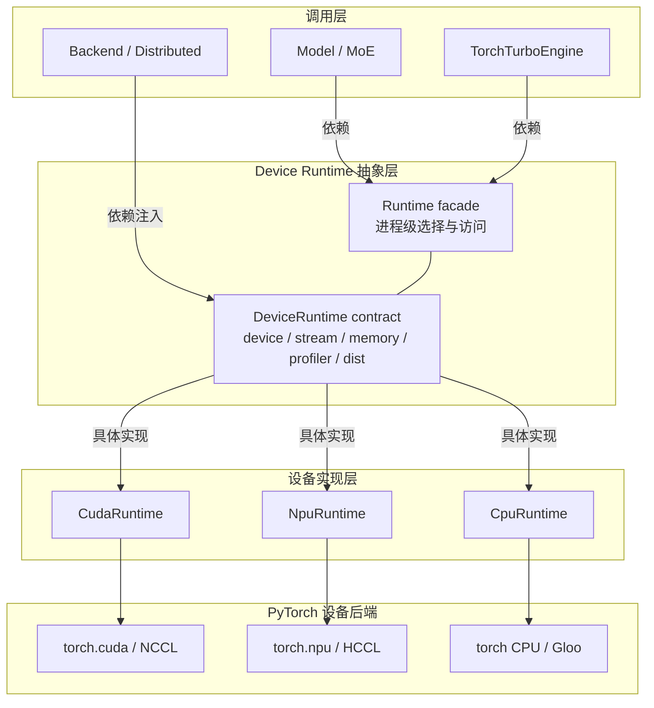
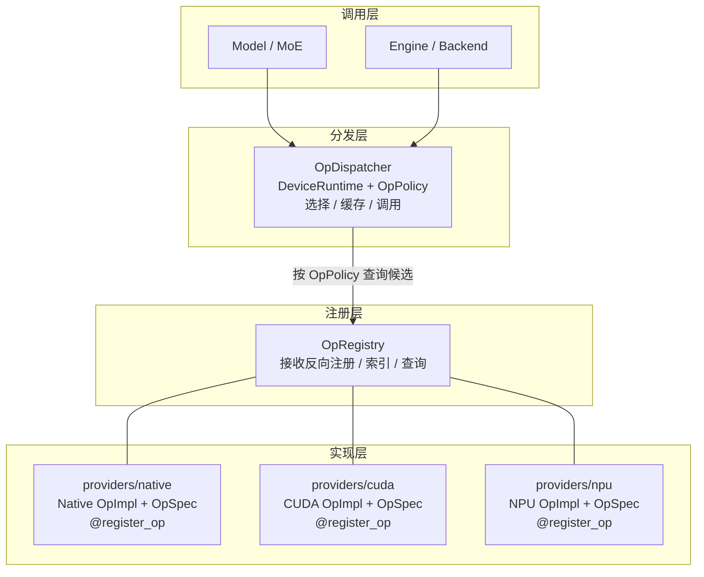
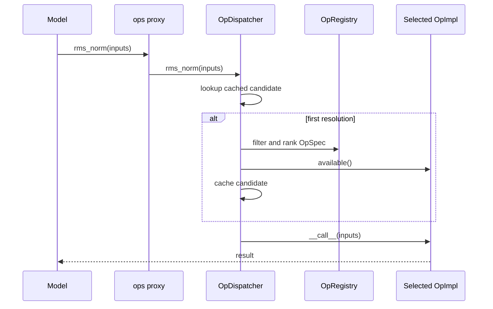

# Device Runtime 与算子注册分发

本文描述 TorchTurbo 的 Device Runtime 抽象、算子注册与分发机制，以及新增和调用一个算子的流程。

## 设计原则

当前设备执行层由两个相互独立的抽象组成：

- **Device Runtime** 负责“当前进程在哪种设备上运行，以及如何操作该设备”；
- **Ops** 负责“业务需要什么计算语义，以及当前设备选择哪个实现”。

Engine 负责建立两者的进程级生命周期，并将同一个 Runtime 交给 Backend 和
OpDispatcher。Model、Engine 和 MoE 公共组件通过 Runtime 使用设备能力，通过
Ops 调用具有稳定语义的算子。

设计原则如下：

1. **语义与实现分离**：模型依赖稳定的 op 名称和参数契约，不依赖某个硬件库。
2. **单一设备事实源**：一个进程只选择一个 runtime，Backend 和 Dispatcher 使用
   同一个 runtime 实例。
3. **严格策略**：`native` 和 `custom` 不做跨策略隐式 fallback；没有符合策略的
   实现时，算子调用会明确报错。
4. **原生实现优先作为基准**：可以用 PyTorch 表达的算子应提供 native 实现，
   同时作为正确性基准和 `auto` fallback。
5. **依赖按需加载**：只发现 native provider 和当前设备 provider；可选依赖在
   `available()` 或真正调用时导入。
6. **选择结果可观测**：Engine 初始化时输出每个 op 最终选择的实现、类型、优先级
   和 fallback 状态。

## 整体架构

以下两张图只表示组件分层和依赖关系，不表示张量、控制或注册数据的流转过程。
具体算子调用过程见后文“调用链”。

### Device Runtime 架构



### 算子注册与分发架构



调用层访问 `OpDispatcher`。Dispatcher 根据 `DeviceRuntime` 和 `OpPolicy` 查询
`OpRegistry` 中的候选。每个具体 `OpImpl` 都携带自己的 `OpSpec`，并通过
`@register_op` 一起反向注册到 Registry。

各层职责：

| 组件 | 职责 | 不负责 |
| --- | --- | --- |
| `DeviceRuntime` | 设备选择、初始化、stream、同步、显存、随机种子、profiler、分布式 backend | 选择具体算子实现 |
| `OpRegistry` | 注册、索引和查询 op 实现元数据 | 导入硬件依赖、执行算子 |
| Provider | 提供带 `OpSpec` 的 native、CUDA 或 NPU `OpImpl` | 决定全局策略 |
| `OpDispatcher` | 发现 provider，根据 device、policy、priority 和 availability 选择实现 | 改变算子语义 |
| `ops` proxy | 为模型代码提供进程级调用入口 | 初始化 Dispatcher |
| `TorchTurboEngine` | 统一创建 runtime、backend 和进程级 Dispatcher | 在模型内硬编码设备分支 |

## Device Runtime

### 接口边界

[`DeviceRuntime`](../../src/torchturbo/runtime/base.py) 是设备能力的抽象基类。
当前实现包括：

| Runtime | `TurboDevice` | `torch.device` | 分布式 backend |
| --- | --- | --- | --- |
| `CudaRuntime` | `CUDA` | `torch.device("cuda")` | `nccl` |
| `NpuRuntime` | `NPU` | `torch.device("npu")` | `hccl` |
| `CpuRuntime` | `CPU` | `torch.device("cpu")` | `gloo` |

`TurboDevice` 是 Dispatcher 用于匹配 provider 的稳定枚举；`runtime.device` 是传给
PyTorch API 的 `torch.device`。两者用途不同，不应混用。

Runtime 统一提供以下能力：

- `available()` / `initialize()`：探测并初始化设备环境；
- `current_device()` / `set_device()`：管理当前设备；
- `synchronize()` / `empty_cache()` / `memory_info()`：同步和显存管理；
- `stream()` / `current_stream()` / `new_stream()`：设备 stream；
- `manual_seed_all()`：设备随机种子；
- `profiler()`：创建设备对应的 profiler；
- `dist_backend`：为默认 process group 提供 backend 名称。

因此 Backend 和模型公共组件应依赖注入的 `DeviceRuntime`，而不是自行调用
`torch.cuda` 或 `torch.npu`。

### 自动选择与生命周期

[`get_device_runtime()`](../../src/torchturbo/runtime/runtime.py) 按以下固定顺序选择
第一个可用设备：

```text
CUDA -> NPU -> CPU
```

选中的 runtime 会执行一次 `initialize()`，随后缓存在进程级
`_SELECTED_RUNTIME` 中。同一进程后续调用得到同一个实例。

Engine 初始化顺序为：

1. 解析 `EngineConfig`；
2. 调用 `get_device_runtime()` 选择进程 runtime；
3. 将该 runtime 注入 Backend；
4. 使用同一 runtime 创建或复用 `OpDispatcher`；
5. 输出算子选择表。

### “设备可用”不等于“当前设备”

`is_cuda_available()` 和 `is_npu_available()` 只回答机器上对应设备是否可用，
不表示该设备已被当前进程选中。例如 CUDA 和 NPU 同时可用时，自动选择结果是
CUDA。

需要根据当前运行设备选择行为时，应使用：

```python
from torchturbo.runtime import TurboDevice, get_device_runtime


runtime = get_device_runtime()
if runtime.turbo_device is TurboDevice.NPU:
    ...
```

不要使用 `is_npu_available()` 给当前模型安装 NPU patch，否则在 CUDA 与 NPU
共存的环境中可能给 CUDA 模型安装 NPU 实现。

## 算子模型

### 核心概念

一个逻辑算子可以有多个实现：

```text
op_name = rms_norm
├── torch_rms_norm       native, all devices, priority=0
└── npu_rms_norm         custom, NPU only, priority=100
```

各对象含义如下：

- **op**：业务层看到的稳定语义，例如 `rms_norm`；
- **implementation**：某个具体实现，例如 `npu_rms_norm`；
- **`OpSpec`**：实现的元数据，包括名称、类型、优先级和支持设备；
- **`OpImpl`**：实现类，提供 `available()` 和 `__call__()`；
- **provider**：按 native、CUDA、NPU 组织实现文件的目录；
- **registry**：保存 `OpSpec`；
- **dispatcher**：根据当前环境选择 `OpImpl` 并执行。

当前目录结构：

```text
src/torchturbo/ops/
├── base.py                 # OpPolicy、OpImplKind、OpSpec、OpImpl
├── registry.py             # @register_op 和全局 OpRegistry
├── dispatcher.py           # provider 发现、选择、缓存和调用 facade
├── ops.py                  # 进程级 Dispatcher 和 ops proxy
└── providers/
    ├── native/             # 所有 runtime 都会发现的 PyTorch 实现
    ├── cuda/               # 仅 CUDA runtime 发现
    └── npu/                # 仅 NPU runtime 发现
```

### Provider 发现与注册

Dispatcher 创建时会扫描：

```text
providers/native + providers/<selected runtime>
```

例如 NPU 进程会扫描 `native/` 和 `npu/`，不会导入 `cuda/`。扫描使用
`pkgutil.walk_packages`，因此新增普通 `.py` 文件后不需要维护手工 provider 清单。

发现过程同时完成两件事：

1. 导入模块，使 `@register_op` 把 `OpSpec` 写入全局 registry；
2. 收集该模块中定义的 `OpImpl` 子类，建立 `impl_name -> class` 索引。

Provider 文件名不应以 `_` 开头；实现类应直接定义在 provider 模块中，而不是只
从其他模块 re-export，否则自动发现会忽略它。

### 实现选择

Dispatcher 按以下顺序选择实现：

1. 如果调用点传入了 `impl=`，直接使用该实现；
2. 否则，如果 `OpsConfig.overrides` 为当前 op 指定了实现，使用配置中的实现；
3. 如果没有显式指定实现，进入自动选择：
   - **3.1 设备过滤**：保留当前 op 中 `devices=()` 或包含当前
     `TurboDevice` 的实现；
   - **3.2 Policy 过滤**：根据 `OpPolicy` 保留 native、custom 或两者；
   - **3.3 优先级排序**：按 `priority` 从高到低排序；
   - **3.4 同优先级排序**：设备专用实现优先于通用实现，custom 优先于 native；
   - **3.5 可用性检查**：依次调用 `available()`，选择第一个可用实现。

前两种属于显式选择，不会再比较其他实现；指定的实现与当前 op 或设备不匹配，
或者依赖不可用时会直接报错，不会自动换用其他实现。调用点 `impl=` 只影响当前调用，
优先级高于配置覆盖。

`priority=0` 通常用于 native 基准实现，设备加速实现通常使用更高优先级，例如
`50` 或 `100`。优先级表达同一策略内的实现偏好，不能改变严格 policy 的边界。

### Policy 语义

| Policy | 候选实现 | 不可用时的行为 | 适用场景 |
| --- | --- | --- | --- |
| `auto` | native + custom | 按排序尝试后续候选，通常从 custom 回退 native | 默认训练和推理 |
| `native` | 仅 native | 没有 native 实现时直接报错 | 对齐、排障、强制 PyTorch 实现 |
| `custom` | 仅 custom | 没有 custom 实现时直接报错 | 性能验证、强制融合实现 |

严格 policy 是有意设计。例如 NPU 上某个 op 没有 native 实现时，
`policy=native` 报错是正确行为，Dispatcher 不应偷偷调用 custom 实现。

调用方也可以通过 `impl=` 指定实现：

```python
output = ops.rms_norm(
    hidden_states,
    weight,
    eps,
    impl="torch_rms_norm",
)
```

显式 `impl` 跳过默认 policy 选择，但仍会校验 op 名称、设备兼容性和
`available()`。`impl` 是 Dispatcher 保留关键字，不应作为业务算子参数名。

### 进程级 Dispatcher

`TorchTurboEngine` 使用 `get_or_create_ops()` 创建进程级 Dispatcher。后续 Engine
只有在 device、policy 和 per-op overrides 都一致时才能复用它；
冲突配置会报错，避免已经构造的模型在运行中悄悄切换实现。

`from torchturbo.ops import ops` 得到的是延迟代理。真正调用时它会访问进程级
Dispatcher，因此必须先完成以下任一初始化：

- 创建 `TorchTurboEngine`；
- 在独立脚本中显式调用 `get_or_create_ops()`。

未初始化就调用会得到 `Ops dispatcher is not configured`，这是生命周期错误，
不是 provider fallback 条件。

## 调用链

以 `ops.rms_norm(...)` 为例：



Engine 创建 Dispatcher 时会预解析默认候选，所以正常 Engine 路径中，大部分 op
在第一次模型调用前已经完成默认实现选择。显式 `impl=` 使用独立缓存项。

## 新增一个算子

下面用 `scaled_add(x, y, alpha=...)` 作为例子。

### 1. 先定义语义契约

在写 provider 前明确以下内容，并保证所有实现一致：

- 参数名、位置参数和关键字参数；
- 输入支持的 shape、dtype 和 device；
- 输出 shape、dtype 和 device；
- 空 tensor、singleton 维度和特殊参数的行为；
- autograd 语义；
- 异常类型和边界条件。

Dispatcher 只选择实现，不会修复 provider 之间的语义差异。native 实现应作为
后续 custom 实现的对齐基准。

### 2. 添加 native provider

创建 `src/torchturbo/ops/providers/native/scaled_add.py`：

```python
from __future__ import annotations

import torch

from ...base import OpImpl, OpImplKind
from ...registry import register_op


@register_op(
    op_name="scaled_add",
    impl_name="torch_scaled_add",
    kind=OpImplKind.NATIVE,
    priority=0,
    devices=(),
)
class TorchScaledAdd(OpImpl):
    def __call__(
        self,
        x: torch.Tensor,
        y: torch.Tensor,
        *,
        alpha: float = 1.0,
    ) -> torch.Tensor:
        return torch.add(x, y, alpha=alpha)
```

`devices=()` 表示实现与 runtime 无关。只要底层 PyTorch 算子支持对应 tensor
device，它就可以作为 CUDA、NPU 和 CPU 的 native 候选。

`impl_name` 必须在整个 registry 中唯一，也不能使用 `auto`、`native` 或
`custom` 这些保留名称。

### 3. 添加设备 custom provider

如果 NPU 有融合实现，创建
`src/torchturbo/ops/providers/npu/scaled_add.py`：

```python
from __future__ import annotations

import torch

from torchturbo.runtime import TurboDevice

from ...base import OpImpl, OpImplKind
from ...registry import register_op


@register_op(
    op_name="scaled_add",
    impl_name="npu_scaled_add",
    kind=OpImplKind.CUSTOM,
    priority=100,
    devices=(TurboDevice.NPU,),
)
class NpuScaledAdd(OpImpl):
    def available(self) -> bool:
        try:
            from my_project_npu_kernels import scaled_add  # noqa: F401
        except ImportError:
            return False
        return True

    def __call__(
        self,
        x: torch.Tensor,
        y: torch.Tensor,
        *,
        alpha: float = 1.0,
    ) -> torch.Tensor:
        from my_project_npu_kernels import scaled_add

        return scaled_add(x, y, alpha=alpha)
```

注意：

- 可选硬件依赖不要在模块顶层导入；
- `available()` 应只判断实现能否安全调用，不应改变全局 runtime；
- `__call__()` 的签名和语义必须与 native 实现一致；
- NPU custom 实现只能声明 `devices=(TurboDevice.NPU,)`；
- 新文件会被自动发现，不需要修改 provider `__init__.py`。

CUDA 实现采用相同方式放入 `providers/cuda/`，并声明
`devices=(TurboDevice.CUDA,)`。

### 4. 决定是否添加显式 facade

Dispatcher 的 `__getattr__` 会为已注册 op 动态创建 facade，因此不修改
`dispatcher.py` 也可以直接调用：

```python
result = ops.scaled_add(x, y, alpha=0.5)
```

如果该 op 是稳定的公共接口，或者希望获得明确签名、类型提示和 IDE 支持，可以在
`OpDispatcher` 中添加显式方法：

```python
def scaled_add(
    self,
    x,
    y,
    *,
    alpha: float = 1.0,
    impl: str | None = None,
):
    return self._dispatch(
        "scaled_add",
        x,
        y,
        alpha=alpha,
        impl=impl,
    )
```

显式 facade 只负责稳定调用签名，不包含设备判断或 fallback 逻辑。

### 5. 在 Engine 或模型中调用

Engine 初始化后，模型和公共组件可以使用进程级 proxy：

```python
from torchturbo.ops import ops


def forward(x, y):
    return ops.scaled_add(x, y, alpha=0.5)
```

已有 Engine 实例时也可以直接调用：

```python
result = engine.ops.scaled_add(x, y, alpha=0.5)
```

独立脚本不创建 Engine 时，应显式完成初始化：

```python
from torchturbo.ops import OpPolicy, get_or_create_ops
from torchturbo.runtime import get_device_runtime


runtime = get_device_runtime()
dispatcher = get_or_create_ops(
    device_runtime=runtime,
    default_policy=OpPolicy.AUTO,
)
result = dispatcher.scaled_add(x, y, alpha=0.5)
```

模型代码不应写成：

```python
if is_npu_available():
    return npu_scaled_add(x, y)
return torch.add(x, y)
```

这种分支重复了 runtime 选择和 Dispatcher 职责，也会在多种设备同时可用时选错
实现。

### 6. 配置 policy

直接构造配置：

```python
from torchturbo.engine import EngineConfig, OpsConfig
from torchturbo.ops import OpPolicy


config = EngineConfig(
    ops=OpsConfig(
        policy=OpPolicy.AUTO,
        overrides={
            "rms_norm": "torch_rms_norm",
        },
    ),
)
```

从字典或 JSON 恢复配置：

```python
config = EngineConfig.from_dict(
    {
        "ops": {
            "policy": "native",
            "overrides": {
                "rms_norm": "torch_rms_norm",
            },
        },
    }
)
```

支持 TorchTurbo `--tt_*` 参数解析的入口也可以使用命令行或环境变量：

```bash
python your_entry.py --tt_op_policy custom
TORCH_TURBO_OP_POLICY=native python your_entry.py
```

`overrides` 按 op 名称指定具体 `impl_name`，并由 Engine 交给进程级 Dispatcher。
配置覆盖不会 fallback，无效时 Dispatcher 初始化直接报错。Dispatcher 只发现
native 和当前 Runtime 的 provider，因此只能配置与当前 Runtime 匹配的实现。

### 7. 添加测试

至少覆盖 native 语义和 Dispatcher 集成：

```python
import torch

from torchturbo.ops import OpDispatcher
from torchturbo.ops.registry import registry
from torchturbo.runtime.cpu import CpuRuntime


def test_scaled_add_native_dispatch():
    dispatcher = OpDispatcher(
        device_runtime=CpuRuntime(),
        registry=registry,
    )
    x = torch.tensor([1.0, 2.0])
    y = torch.tensor([3.0, 4.0])

    actual = dispatcher.scaled_add(x, y, alpha=0.5)
    expected = torch.add(x, y, alpha=0.5)

    torch.testing.assert_close(actual, expected)
```

设备 custom 实现还应覆盖：

- 与 native 实现的数值对齐；
- shape、dtype、device 和 reduction 等接口语义；
- backward 或梯度对齐；
- 可选依赖缺失时，`auto` 是否正确 fallback；
- `native` / `custom` 严格策略下是否按预期选择或报错；
- 显式 `impl=` 是否选择指定实现；
- 空输入、单元素输入和非连续输入等边界。

硬件测试应使用 `pytest.importorskip()` 或在测试内部导入可选依赖，避免 CPU
环境在 collection 阶段因缺少 `torch_npu` 等包而直接失败。

现有通用测试入口：

```bash
PYTHONPATH=src pytest -q tests/ops/test_dispatch.py
PYTHONPATH=src pytest -q tests/runtime/test_runtime.py
```

## 常见问题

### `No implementation for op=...`

依次检查：

1. provider 文件是否位于 `native/` 或当前 runtime 对应目录；
2. 文件名是否以 `_` 开头；
3. 实现类是否在该模块中直接定义；
4. `op_name` 和 `impl_name` 是否正确；
5. `devices` 是否包含当前 `TurboDevice`；
6. 当前 policy 是否过滤了该 `kind`；
7. `available()` 是否因可选依赖缺失返回 `False`。

### `Ops dispatcher is not configured`

调用发生在 Engine 或 `get_or_create_ops()` 初始化之前。调整生命周期，不要在
provider 或模型模块 import 阶段执行 `ops.xxx()`。

### `policy=native` 在 NPU 上报错

先确认该 op 是否注册了 native 实现。如果只有 NPU custom 实现，报错符合严格
policy 语义。需要 fallback 时使用 `auto`，需要强制融合实现时使用 `custom`。

### 日志显示 `fallback`

表示排序更靠前的候选 `available()` 返回了 `False`，Dispatcher 选择了后续可用
实现。Engine 初始化日志中的 `Unavailable details` 会给出无法解析的 op 信息。

## 新增一种 Device Runtime

新增设备类型通常需要：

1. 在 `TurboDevice` 中增加枚举值；
2. 实现 `DeviceRuntime` 的全部抽象方法和 `dist_backend`；
3. 在 `_build_runtime()` 中创建实例，并决定自动探测顺序；
4. 在 `providers/` 下增加设备目录；
5. 扩展 `iter_provider_modules()` 的设备映射；
6. 添加 availability、初始化、stream、memory、profiler 和分发测试。

Runtime 的 `initialize()` 只应在该设备真正被选中后执行。硬件包探测和 provider
导入也应保持惰性，避免未选中的设备改变进程状态。

## 相关源码

- [`runtime/base.py`](../../src/torchturbo/runtime/base.py)：runtime 抽象；
- [`runtime/runtime.py`](../../src/torchturbo/runtime/runtime.py)：探测和进程级选择；
- [`ops/base.py`](../../src/torchturbo/ops/base.py)：op 元数据与实现接口；
- [`ops/registry.py`](../../src/torchturbo/ops/registry.py)：注册表；
- [`ops/providers/__init__.py`](../../src/torchturbo/ops/providers/__init__.py)：provider 自动发现；
- [`ops/dispatcher.py`](../../src/torchturbo/ops/dispatcher.py)：选择、缓存和调用；
- [`ops/ops.py`](../../src/torchturbo/ops/ops.py)：进程级 Dispatcher 与 proxy；
- [`engine/core.py`](../../src/torchturbo/engine/core.py)：Engine 生命周期接入；
- [`tests/ops/test_dispatch.py`](../../tests/ops/test_dispatch.py)：分发行为测试；
- [`tests/runtime/test_runtime.py`](../../tests/runtime/test_runtime.py)：runtime 契约测试。
