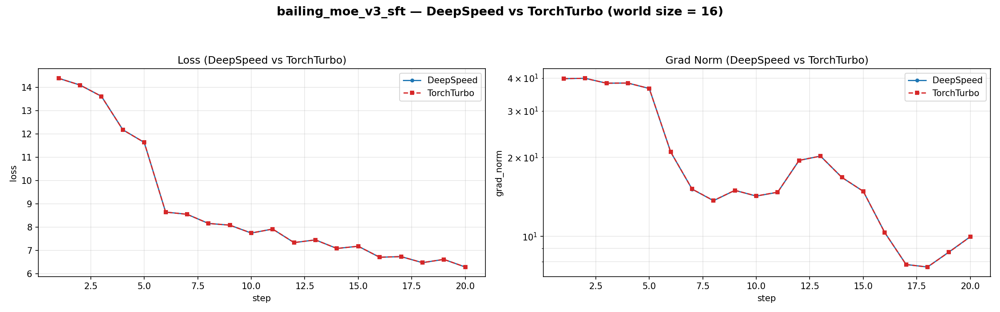

# Bailing MoE V3

## 运行脚本

`scripts/runs/lf_bailing_moe_v3_sft.sh`

### AIStudio 环境

```python
import os
from pypai.job import PythonJobBuilder
from pypai.conf import ExecConf
from pypai.conf import KMConf
from pypai.conf import GpuType
from pypai.conf import AlertConf
from aistudio_common.openapi.models import DataStore

def update_pypai():
    # install dependencies
    import subprocess
    try:
        subprocess.run(["pip", "install", "--upgrade", "aii-pypai"], check=True)
        print("pip executes succeeded!")
    except subprocess.CalledProcessError as e:
        print(f"pip executes failed with code {e.returncode}")

def torch_train():
    update_pypai()
    a3_sfs_old = DataStore(mount_point="/sfs_turbo", store_name="wl02-antfinix-sfs")
    a3_sfs_new = DataStore(mount_point="/mnt/sfs_turbo", store_name="wl02-aicompiler-sfs")
    km_conf = KMConf(
        # bailing moe v3
        image="hcr.meta-wulan01.hw-wulan.local/aii/aistudio:17940140-20260427141323_aarch64"
    )

    labels={
        "\"sigma.ali/rack-group-num\"":"1",
    }
    edl_job_args = "--critical_worker_index=0:2 --relaunch_always=false --relaunch_count 0"

    annotations = {
        "ELASTICDL_MASTER_CONFIGURATION": '{"cpu": 4, "memory": 2048, "image":"hcr.meta-wulan01.hw-wulan.local/kubemaker/elasticdl:test-aarch64-bc4298b59706f305893044af221fa99880ae2210"}'
    }

    node_gpu_num = 16
    node_num = 1

    env_dir = '/sfs_turbo/zhisan/0507/'
    command = ""
    command += f"export NPUS_PER_NODE={node_gpu_num} && export NNODES={node_num} && "
    command += f"pip list && source /usr/local/Ascend/ascend-toolkit/set_env.sh && echo 'cannVersion: ', $ASCEND_TOOLKIT_HOME && \
        cd /sfs_turbo/zlj/workspace/LLaMA-Factory && \
        pip install -r requirements.txt -i https://pypi.antfin-inc.com/simple/ && \
        pip install deepspeed==0.16.0 -i https://pypi.antfin-inc.com/simple/ && \
        pip install transformers==4.57.3 -i https://pypi.antfin-inc.com/simple/ && \
        pip install tensorboard -i https://pypi.antfin-inc.com/simple/ && \
        pip install /sfs_turbo/zhisan/envs/triton_ascend-3.5.1.dev2026042622-cp311-cp311-manylinux_2_27_aarch64.manylinux_2_28_aarch64.whl --no-deps && \
        cd {env_dir}/flash-linear-attention && \
        pip install -e . --force-reinstall --no-deps -i https://pypi.antfin-inc.com/simple/ && \
        /sfs_turbo/zhisan/envs/ascendnpu-ir_1.1.0_linux-aarch64.run --install && \
        pip list && "

    command += ' sleep inf'
    name = 'bailing_moe_v3_env'

    master= ExecConf(cpu=256, memory=2000000, gpu_num=node_gpu_num, num=1, shared_memory=20480, gpu_type="hpu910c", disk_m=192000)
    worker = ExecConf(cpu=256, memory=2000000, gpu_num=node_gpu_num, num=node_num-1, shared_memory=20480, gpu_type="hpu910c", disk_m=192000)
    # worker = ExecConf(cpu=256, memory=2000000, gpu_num=node_gpu_num, num=node_num, shared_memory=20480, gpu_type="hpu910c", disk_m=192000)
    job = PythonJobBuilder(# source_root="./",
                           main_file="", #命令模式必填空，详情参考：https://yuque.antfin-inc.com/aii/aistudio/gpu-job#y3tRY
                           km_conf=km_conf,
                           command=command,
                           platform="kubemaker",
                           k8s_app_name="hpuopt",
                           k8s_priority="high",
                           distribution_strategy="AllreduceStrategy",
                           master=master,
                           worker=worker,
                           runtime="pytorch",
                           name=name,
                           tag="type=SFT,basemodel=ling25",
                           data_stores = [a3_sfs_old, a3_sfs_new],
                           host_network=False,
                           labels=labels,
                           edl_job_args = edl_job_args,)
                          #  annotations=annotations,

    job.run()

if __name__ == "__main__":
    torch_train()
```

## 运行方式

`sh scripts/runs/lf_bailing_moe_v3_sft.sh`

## 和 DeepSpeed 对比

对比配置：

- World size: 16
- DeepSpeed: MLA 部分使用 eager attention
- TorchTurbo: MLA 部分使用 FA2，并开启 SP2 + EP8


