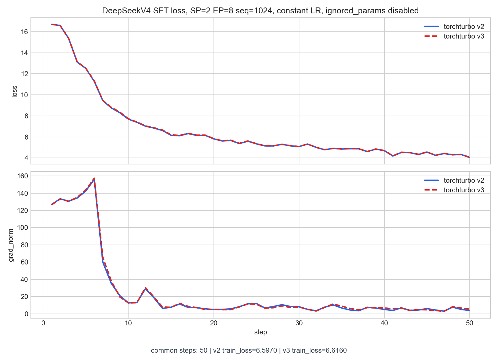

# DeepSeekV4

## 运行脚本

`scripts/runs/lf_deepseek_v4_sft.sh`

## AIStudio 环境

```python
import os
from pypai.job import PythonJobBuilder
from pypai.conf import ExecConf
from pypai.conf import KMConf
from pypai.conf import GpuType
from pypai.conf import AlertConf
from aistudio_common.openapi.models import DataStore

def update_pypai():
    # install dependencies
    import subprocess
    try:
        subprocess.run(["pip", "install", "--upgrade", "aii-pypai"], check=True)
        print("pip executes succeeded!")
    except subprocess.CalledProcessError as e:
        print(f"pip executes failed with code {e.returncode}")

def torch_train():
    update_pypai()
    a3_sfs_old = DataStore(mount_point="/sfs_turbo", store_name="wl02-02-aidc-antfinix-sfs")
    a3_sfs_new = DataStore(mount_point="/mnt/sfs_turbo", store_name="wl02-02-aidc-aicompiler-sfs")
    a3_storage_sfs = DataStore(mount_point="/storage", store_name="wl02-02-aidc-aicompiler-sfs")
    km_conf = KMConf(
        # deepseek v4
        image="hcr.meta-wulan01.hw-wulan.local/aii/aistudio:17940140-20260427141323_aarch64"
    )

    labels={
        "\"sigma.ali/rack-group-num\"":"1",
        "\"kubemaker.alipay.com/enable-pytorch-coscheduling\"": "true"  # 确保 PyTorchJob Pod 同时创建，避免超节点调度失败，【多节点（node_num>1）必须带！】
    }
    edl_job_args = "--critical_worker_index=0:2 --relaunch_always=false --relaunch_count 0"

    annotations = {
        "ELASTICDL_MASTER_CONFIGURATION": '{"cpu": 4, "memory": 2048, "image":"hcr.meta-wulan01.hw-wulan.local/kubemaker/elasticdl:test-aarch64-bc4298b59706f305893044af221fa99880ae2210"}'
    }

    node_gpu_num = 16
    node_num = 1

    command = ""
    command += f"export NPUS_PER_NODE={node_gpu_num} && export NNODES={node_num} && "
    command += f"pip list && source /usr/local/Ascend/ascend-toolkit/set_env.sh && echo 'cannVersion: ', $ASCEND_TOOLKIT_HOME && "

    command += ' sleep inf'
    name = 'deepseek_v4_env'

    master= ExecConf(cpu=256, memory=2000000, gpu_num=node_gpu_num, num=1, shared_memory=20480, gpu_type="hpu910c", disk_m=192000)
    worker = ExecConf(cpu=256, memory=2000000, gpu_num=node_gpu_num, num=node_num-1, shared_memory=20480, gpu_type="hpu910c", disk_m=192000)
    # worker = ExecConf(cpu=256, memory=2000000, gpu_num=node_gpu_num, num=node_num, shared_memory=20480, gpu_type="hpu910c", disk_m=192000)
    job = PythonJobBuilder(# source_root="./",
                           main_file="", #命令模式必填空，详情参考：https://yuque.antfin-inc.com/aii/aistudio/gpu-job#y3tRY
                           km_conf=km_conf,
                           command=command,
                           platform="kubemaker",
                           k8s_app_name="hpuopt",
                           k8s_priority="high",
                           distribution_strategy="AllreduceStrategy",
                           master=master,
                           worker=worker,
                           runtime="pytorch",
                           name=name,
                           tag="type=SFT,basemodel=ling25",
                           data_stores = [a3_sfs_old, a3_sfs_new, a3_storage_sfs],
                           host_network=False,
                           labels=labels,
                           edl_job_args = edl_job_args,)
                          #  annotations=annotations,

    job.run()

if __name__ == "__main__":
    torch_train()
```

## 运行方式

```bash
sh scripts/runs/npu_deps/deepseek_v4_deps.sh
sh scripts/runs/lf_deepseek_v4_sft.sh
```

## torchturbo v2 对比

配置：

- 单机 16 卡，world size = 16
- sequence parallel size = 2
- expert parallel size = 8
- seq_length = 1024
- max_steps = 50
- lr_scheduler_type = constant
- ignored_params disabled

这里使用 constant LR 做对比，避免 torchturbo v2 中 scheduler 先绑定旧 optimizer、真实训练 optimizer 被替换后 `--lr_scheduler_type cosine` 未实际作用到训练 optimizer 的差异。



结果摘要：

- v2 train_loss = 6.597
- v3 train_loss = 6.616

## 对齐测试

DeepSeekV4 额外提供模块级对齐入口：

```bash
python tests/models/deepseek_v4/run_alignment.py --mode all
python tests/models/deepseek_v4/run_alignment.py --mode ops
python tests/models/deepseek_v4/run_alignment.py --mode modeling-vs-infer
python tests/models/deepseek_v4/run_alignment.py --mode turbo-vs-modeling
```

## 原始数据

| step | v2 loss | v2 grad_norm | v3 loss | v3 grad_norm |
| --- | ---: | ---: | ---: | ---: |
| 1 | 16.71 | 126.9 | 16.71 | 126.5 |
| 2 | 16.59 | 133.4 | 16.59 | 133.1 |
| 3 | 15.36 | 130.7 | 15.37 | 130.5 |
| 4 | 13.11 | 134.4 | 13.13 | 135.1 |
| 5 | 12.52 | 142.4 | 12.54 | 143.6 |
| 6 | 11.28 | 156 | 11.34 | 157.3 |
| 7 | 9.453 | 60.07 | 9.48 | 65.64 |
| 8 | 8.756 | 35.25 | 8.81 | 37.94 |
| 9 | 8.296 | 21.03 | 8.355 | 19.5 |
| 10 | 7.689 | 12.71 | 7.722 | 12.63 |
| 11 | 7.388 | 13.19 | 7.411 | 12.89 |
| 12 | 7.02 | 29.13 | 7.045 | 30.45 |
| 13 | 6.843 | 18.55 | 6.869 | 19.51 |
| 14 | 6.609 | 6.274 | 6.652 | 7.912 |
| 15 | 6.156 | 7.663 | 6.2 | 7.555 |
| 16 | 6.107 | 11.43 | 6.144 | 12.19 |
| 17 | 6.319 | 7.449 | 6.334 | 8.681 |
| 18 | 6.141 | 7.121 | 6.17 | 7.247 |
| 19 | 6.149 | 5.793 | 6.174 | 5.002 |
| 20 | 5.816 | 5.001 | 5.834 | 5.159 |
| 21 | 5.612 | 5.127 | 5.633 | 4.786 |
| 22 | 5.662 | 5.74 | 5.687 | 4.883 |
| 23 | 5.366 | 8.204 | 5.387 | 7.963 |
| 24 | 5.592 | 11.67 | 5.614 | 11.46 |
| 25 | 5.341 | 11.96 | 5.361 | 11.12 |
| 26 | 5.144 | 6.744 | 5.158 | 6.518 |
| 27 | 5.141 | 8.439 | 5.151 | 7.046 |
| 28 | 5.297 | 10.57 | 5.297 | 9.232 |
| 29 | 5.151 | 8.445 | 5.16 | 7.363 |
| 30 | 5.077 | 8.212 | 5.089 | 7.887 |
| 31 | 5.319 | 5.199 | 5.324 | 5.182 |
| 32 | 5.009 | 3.511 | 5.007 | 3.258 |
| 33 | 4.778 | 7.702 | 4.781 | 7.331 |
| 34 | 4.907 | 10.35 | 4.909 | 11.44 |
| 35 | 4.845 | 6.795 | 4.856 | 8.917 |
| 36 | 4.877 | 4.448 | 4.891 | 6.228 |
| 37 | 4.867 | 3.551 | 4.877 | 4.522 |
| 38 | 4.602 | 7.584 | 4.609 | 7.147 |
| 39 | 4.84 | 6.727 | 4.852 | 6.995 |
| 40 | 4.694 | 5.125 | 4.701 | 6.83 |
| 41 | 4.185 | 3.892 | 4.202 | 5.892 |
| 42 | 4.523 | 6.922 | 4.543 | 6.736 |
| 43 | 4.502 | 4.038 | 4.517 | 3.844 |
| 44 | 4.324 | 4.435 | 4.347 | 4.926 |
| 45 | 4.558 | 6.034 | 4.571 | 4.611 |
| 46 | 4.245 | 4.406 | 4.257 | 3.894 |
| 47 | 4.421 | 3.136 | 4.431 | 2.779 |
| 48 | 4.293 | 7.735 | 4.304 | 8.228 |
| 49 | 4.325 | 5.178 | 4.335 | 6.694 |
| 50 | 4.045 | 3.876 | 4.066 | 5.399 |
