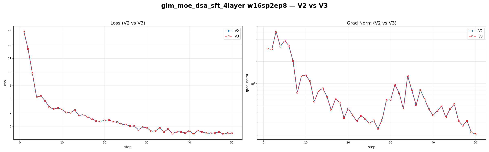

# GLM MoE DSA

## 运行脚本

`scripts/runs/lf_glm_moe_dsa_sft.sh`

## AIStudio 环境

```python
import os
from pypai.job import PythonJobBuilder
from pypai.conf import ExecConf
from pypai.conf import KMConf
from pypai.conf import GpuType
from pypai.conf import AlertConf
from aistudio_common.openapi.models import DataStore

def update_pypai():
    # install dependencies
    import subprocess
    try:
        subprocess.run(["pip", "install", "--upgrade", "aii-pypai"], check=True)
        print("pip executes succeeded!")
    except subprocess.CalledProcessError as e:
        print(f"pip executes failed with code {e.returncode}")

def torch_train():
    update_pypai()
    a3_sfs_old = DataStore(mount_point="/sfs_turbo", store_name="wl02-02-aidc-antfinix-sfs")
    a3_sfs_new = DataStore(mount_point="/mnt/sfs_turbo", store_name="wl02-02-aidc-aicompiler-sfs")
    km_conf = KMConf(
        # glm5
        image="hcr.meta-wulan01.hw-wulan.local/atorch/atorch-dev-ascend_alios:deepseek-3.2-cann850-91c52d4d-20260121175052"
    )

    labels={
        "\"sigma.ali/rack-group-num\"":"1",
    }
    edl_job_args = "--critical_worker_index=0:2 --relaunch_always=false --relaunch_count 0"

    annotations = {
        "ELASTICDL_MASTER_CONFIGURATION": '{"cpu": 4, "memory": 2048, "image":"hcr.meta-wulan01.hw-wulan.local/kubemaker/elasticdl:test-aarch64-bc4298b59706f305893044af221fa99880ae2210"}'
    }

    node_gpu_num = 16
    node_num = 1

    # glm5
    command = ''
    command += 'source /root/.bashrc && '
    command += f'export NPUS_PER_NODE={node_gpu_num} && export NNODES={node_num} && '
    command += "pip list && echo 'cannVersion: ', $ASCEND_TOOLKIT_HOME && \
        pip install pynvml --trusted-host repo.huaweicloud.com && \
        cd /mnt/sfs_turbo/shanyicheng.syc/code/ && ./cann-ops-transformer-custom_linux-aarch64.run && \
        cd /root && \
        source /mnt/sfs_turbo/hw/dengshumin/CANN_2/ascend-toolkit/set_env.sh && \
        source /mnt/sfs_turbo/hw/dengshumin/CANN_2/nnal/atb/set_env.sh && \
        wget  https://gpu-wulanchabu-aistudiocode.oss-cn-wulanchabu.aliyuncs.com/040846/dlrover-0.6.0rc730-py3-none-any.whl && \
        pip install dlrover-0.6.0rc730-py3-none-any.whl --trusted-host repo.huaweicloud.com && \
        pip install grpcio --trusted-host repo.huaweicloud.com && \
        cd /mnt/sfs_turbo/shanyicheng.syc/code/LLaMA-Factory && \
        pip install -r requirements.txt && \
        pip install deepspeed==0.16.0 && \
        pip install transformers==4.57.3 && \
        export ASCEND_PROCESS_LOG_PATH=/sfs_turbo/hw/liyanlong/log/plog/penglanqian/GLM5/ && \
        pip list && "

    command += ' sleep inf'
    name = 'glm_moe_dsa_env'

    master= ExecConf(cpu=256, memory=2000000, gpu_num=node_gpu_num, num=1, shared_memory=20480, gpu_type="hpu910c", disk_m=192000)
    worker = ExecConf(cpu=256, memory=2000000, gpu_num=node_gpu_num, num=node_num-1, shared_memory=20480, gpu_type="hpu910c", disk_m=192000)
    # worker = ExecConf(cpu=256, memory=2000000, gpu_num=node_gpu_num, num=node_num, shared_memory=20480, gpu_type="hpu910c", disk_m=192000)
    job = PythonJobBuilder(# source_root="./",
                           main_file="", #命令模式必填空，详情参考：https://yuque.antfin-inc.com/aii/aistudio/gpu-job#y3tRY
                           km_conf=km_conf,
                           command=command,
                           platform="kubemaker",
                           k8s_app_name="hpuopt",
                           k8s_priority="high",
                           distribution_strategy="AllreduceStrategy",
                           master=master,
                           worker=worker,
                           runtime="pytorch",
                           name=name,
                           tag="type=SFT,basemodel=ling25",
                           data_stores = [a3_sfs_old, a3_sfs_new],
                           host_network=False,
                           labels=labels,
                           edl_job_args = edl_job_args,)
                          #  annotations=annotations,

    job.run()

if __name__ == "__main__":
    torch_train()
```

## 运行方式

```bash
conda activate sftenv
sh scripts/runs/lf_glm_moe_dsa_sft.sh
```

## torchturbo v2 对比

配置：

- 单机 16 卡，world size = 16
- sequence parallel size = 2
- expert parallel size = 8
- number_hidden_layer = 4
- 前 3 层为 dense MLP，第 4 层为 MoE



### 原始数据

#### V2

```text
{'loss': 12.9805, 'grad_norm': 30.040403366088867, 'learning_rate': 1.25e-05, 'epoch': 0.0}
{'loss': 11.6758, 'grad_norm': 29.079824447631836, 'learning_rate': 1.249922895301038e-05, 'epoch': 0.0}
{'loss': 9.9102, 'grad_norm': 51.487213134765625, 'learning_rate': 1.2496916002285823e-05, 'epoch': 0.0}
{'loss': 8.1426, 'grad_norm': 31.978435516357422, 'learning_rate': 1.2493061718512314e-05, 'epoch': 0.0}
{'loss': 8.2285, 'grad_norm': 38.51865005493164, 'learning_rate': 1.2487667052676698e-05, 'epoch': 0.0}
{'loss': 7.877, 'grad_norm': 32.98097229003906, 'learning_rate': 1.248073333583205e-05, 'epoch': 0.0}
{'loss': 7.4043, 'grad_norm': 20.21149253845215, 'learning_rate': 1.2472262278769251e-05, 'epoch': 0.0}
{'loss': 7.2637, 'grad_norm': 7.5186686515808105, 'learning_rate': 1.2462255971594874e-05, 'epoch': 0.0}
{'loss': 7.3477, 'grad_norm': 12.839986801147461, 'learning_rate': 1.2450716883215487e-05, 'epoch': 0.0}
{'loss': 7.2402, 'grad_norm': 12.905818939208984, 'learning_rate': 1.2437647860728485e-05, 'epoch': 0.0}
{'loss': 7.0156, 'grad_norm': 10.755998611450195, 'learning_rate': 1.2423052128719611e-05, 'epoch': 0.0}
{'loss': 7.0039, 'grad_norm': 5.677855014801025, 'learning_rate': 1.2406933288467338e-05, 'epoch': 0.0}
{'loss': 7.1934, 'grad_norm': 7.938679218292236, 'learning_rate': 1.2389295317054307e-05, 'epoch': 0.0}
{'loss': 6.7852, 'grad_norm': 8.585362434387207, 'learning_rate': 1.2370142566386036e-05, 'epoch': 0.0}
{'loss': 6.8633, 'grad_norm': 6.625633716583252, 'learning_rate': 1.2349479762117173e-05, 'epoch': 0.0}
{'loss': 6.6953, 'grad_norm': 4.316022872924805, 'learning_rate': 1.2327312002485478e-05, 'epoch': 0.0}
{'loss': 6.5527, 'grad_norm': 6.156444549560547, 'learning_rate': 1.2303644757053944e-05, 'epoch': 0.0}
{'loss': 6.4004, 'grad_norm': 5.511704444885254, 'learning_rate': 1.2278483865361239e-05, 'epoch': 0.0}
{'loss': 6.3535, 'grad_norm': 3.3858582973480225, 'learning_rate': 1.2251835535480894e-05, 'epoch': 0.0}
{'loss': 6.4355, 'grad_norm': 4.575355529785156, 'learning_rate': 1.2223706342489564e-05, 'epoch': 0.0}
{'loss': 6.4668, 'grad_norm': 3.7339413166046143, 'learning_rate': 1.219410322684471e-05, 'epoch': 0.0}
{'loss': 6.3379, 'grad_norm': 3.060039520263672, 'learning_rate': 1.2163033492672159e-05, 'epoch': 0.0}
{'loss': 6.2949, 'grad_norm': 3.624378204345703, 'learning_rate': 1.213050480596391e-05, 'epoch': 0.01}
{'loss': 6.1504, 'grad_norm': 3.3065967559814453, 'learning_rate': 1.2096525192686672e-05, 'epoch': 0.01}
{'loss': 6.1289, 'grad_norm': 2.856708288192749, 'learning_rate': 1.2061103036801571e-05, 'epoch': 0.01}
{'loss': 6.0137, 'grad_norm': 3.1409969329833984, 'learning_rate': 1.2024247078195543e-05, 'epoch': 0.01}
{'loss': 6.0195, 'grad_norm': 2.417207717895508, 'learning_rate': 1.1985966410524883e-05, 'epoch': 0.01}
{'loss': 5.748, 'grad_norm': 3.216356039047241, 'learning_rate': 1.1946270478971533e-05, 'epoch': 0.01}
{'loss': 5.9355, 'grad_norm': 5.9293365478515625, 'learning_rate': 1.1905169077912622e-05, 'epoch': 0.01}
{'loss': 5.8984, 'grad_norm': 5.987924575805664, 'learning_rate': 1.1862672348503848e-05, 'epoch': 0.01}
{'loss': 5.6309, 'grad_norm': 9.626968383789062, 'learning_rate': 1.18187907761773e-05, 'epoch': 0.01}
{'loss': 5.6641, 'grad_norm': 7.4439568519592285, 'learning_rate': 1.1773535188054336e-05, 'epoch': 0.01}
{'loss': 5.8691, 'grad_norm': 4.447338581085205, 'learning_rate': 1.1726916750274148e-05, 'epoch': 0.01}
{'loss': 5.5762, 'grad_norm': 12.756800651550293, 'learning_rate': 1.1678946965238696e-05, 'epoch': 0.01}
{'loss': 5.8086, 'grad_norm': 8.015946388244629, 'learning_rate': 1.162963766877465e-05, 'epoch': 0.01}
{'loss': 5.4629, 'grad_norm': 5.075501441955566, 'learning_rate': 1.1579001027213076e-05, 'epoch': 0.01}
{'loss': 5.5996, 'grad_norm': 8.183100700378418, 'learning_rate': 1.1527049534387595e-05, 'epoch': 0.01}
{'loss': 5.5898, 'grad_norm': 6.087750434875488, 'learning_rate': 1.1473796008551691e-05, 'epoch': 0.01}
{'loss': 5.5156, 'grad_norm': 4.454602241516113, 'learning_rate': 1.141925358921601e-05, 'epoch': 0.01}
{'loss': 5.6699, 'grad_norm': 3.669559955596924, 'learning_rate': 1.1363435733906398e-05, 'epoch': 0.01}
{'loss': 5.4141, 'grad_norm': 4.256763458251953, 'learning_rate': 1.1306356214843423e-05, 'epoch': 0.01}
{'loss': 5.6895, 'grad_norm': 4.951305866241455, 'learning_rate': 1.1248029115544317e-05, 'epoch': 0.01}
{'loss': 5.5742, 'grad_norm': 3.4537789821624756, 'learning_rate': 1.1188468827348066e-05, 'epoch': 0.01}
{'loss': 5.498, 'grad_norm': 4.503101825714111, 'learning_rate': 1.1127690045864562e-05, 'epoch': 0.01}
{'loss': 5.4844, 'grad_norm': 5.230808258056641, 'learning_rate': 1.1065707767348684e-05, 'epoch': 0.01}
{'loss': 5.5117, 'grad_norm': 3.091488838195801, 'learning_rate': 1.1002537285000195e-05, 'epoch': 0.01}
{'loss': 5.5859, 'grad_norm': 2.661221504211426, 'learning_rate': 1.0938194185190372e-05, 'epoch': 0.01}
{'loss': 5.418, 'grad_norm': 3.097014904022217, 'learning_rate': 1.0872694343616312e-05, 'epoch': 0.01}
{'loss': 5.4922, 'grad_norm': 2.1546359062194824, 'learning_rate': 1.0806053921383823e-05, 'epoch': 0.01}
{'loss': 5.4844, 'grad_norm': 2.0304174423217773, 'learning_rate': 1.073828936101993e-05, 'epoch': 0.01}
{'loss': 5.4727, 'grad_norm': 2.072726011276245, 'learning_rate': 1.0669417382415922e-05, 'epoch': 0.01}
```

#### V3

```text
{'loss': 12.9805, 'grad_norm': 30.04082679748535, 'learning_rate': 1.25e-05, 'epoch': 0.0}
{'loss': 11.6758, 'grad_norm': 29.079814910888672, 'learning_rate': 1.2499998445290245e-05, 'epoch': 0.0}
{'loss': 9.9102, 'grad_norm': 51.493980407714844, 'learning_rate': 1.2499993781161753e-05, 'epoch': 0.0}
{'loss': 8.1426, 'grad_norm': 31.97104263305664, 'learning_rate': 1.2499986007616843e-05, 'epoch': 0.0}
{'loss': 8.2285, 'grad_norm': 38.51192092895508, 'learning_rate': 1.2499975124659383e-05, 'epoch': 0.0}
{'loss': 7.877, 'grad_norm': 32.974117279052734, 'learning_rate': 1.2499961132294788e-05, 'epoch': 0.0}
{'loss': 7.4043, 'grad_norm': 20.200952529907227, 'learning_rate': 1.249994403053002e-05, 'epoch': 0.0}
{'loss': 7.2637, 'grad_norm': 7.514727592468262, 'learning_rate': 1.2499923819373584e-05, 'epoch': 0.0}
{'loss': 7.3477, 'grad_norm': 12.84425163269043, 'learning_rate': 1.2499900498835542e-05, 'epoch': 0.0}
{'loss': 7.2402, 'grad_norm': 12.905165672302246, 'learning_rate': 1.2499874068927488e-05, 'epoch': 0.0}
{'loss': 7.0156, 'grad_norm': 10.751457214355469, 'learning_rate': 1.2499844529662577e-05, 'epoch': 0.0}
{'loss': 7.0039, 'grad_norm': 5.676592826843262, 'learning_rate': 1.2499811881055501e-05, 'epoch': 0.0}
{'loss': 7.1934, 'grad_norm': 7.937264442443848, 'learning_rate': 1.2499776123122505e-05, 'epoch': 0.0}
{'loss': 6.7852, 'grad_norm': 8.579113960266113, 'learning_rate': 1.2499737255881377e-05, 'epoch': 0.0}
{'loss': 6.8633, 'grad_norm': 6.619551181793213, 'learning_rate': 1.2499695279351459e-05, 'epoch': 0.0}
{'loss': 6.6953, 'grad_norm': 4.318507194519043, 'learning_rate': 1.2499650193553628e-05, 'epoch': 0.0}
{'loss': 6.5527, 'grad_norm': 6.1572675704956055, 'learning_rate': 1.2499601998510318e-05, 'epoch': 0.0}
{'loss': 6.4004, 'grad_norm': 5.513142108917236, 'learning_rate': 1.2499550694245505e-05, 'epoch': 0.0}
{'loss': 6.3535, 'grad_norm': 3.385152816772461, 'learning_rate': 1.2499496280784714e-05, 'epoch': 0.0}
{'loss': 6.4355, 'grad_norm': 4.576383590698242, 'learning_rate': 1.2499438758155017e-05, 'epoch': 0.0}
{'loss': 6.4668, 'grad_norm': 3.732987880706787, 'learning_rate': 1.2499378126385031e-05, 'epoch': 0.0}
{'loss': 6.3379, 'grad_norm': 3.0601418018341064, 'learning_rate': 1.249931438550492e-05, 'epoch': 0.0}
{'loss': 6.2949, 'grad_norm': 3.6218204498291016, 'learning_rate': 1.2499247535546395e-05, 'epoch': 0.01}
{'loss': 6.1504, 'grad_norm': 3.304250717163086, 'learning_rate': 1.2499177576542719e-05, 'epoch': 0.01}
{'loss': 6.1289, 'grad_norm': 2.856222152709961, 'learning_rate': 1.2499104508528691e-05, 'epoch': 0.01}
{'loss': 6.0137, 'grad_norm': 3.140028476715088, 'learning_rate': 1.2499028331540666e-05, 'epoch': 0.01}
{'loss': 6.0195, 'grad_norm': 2.4174089431762695, 'learning_rate': 1.2498949045616543e-05, 'epoch': 0.01}
{'loss': 5.748, 'grad_norm': 3.214935064315796, 'learning_rate': 1.2498866650795764e-05, 'epoch': 0.01}
{'loss': 5.9355, 'grad_norm': 5.9271745681762695, 'learning_rate': 1.2498781147119326e-05, 'epoch': 0.01}
{'loss': 5.8984, 'grad_norm': 5.992754936218262, 'learning_rate': 1.2498692534629764e-05, 'epoch': 0.01}
{'loss': 5.6309, 'grad_norm': 9.627856254577637, 'learning_rate': 1.2498600813371164e-05, 'epoch': 0.01}
{'loss': 5.6621, 'grad_norm': 7.44736385345459, 'learning_rate': 1.2498505983389161e-05, 'epoch': 0.01}
{'loss': 5.8711, 'grad_norm': 4.449161529541016, 'learning_rate': 1.2498408044730928e-05, 'epoch': 0.01}
{'loss': 5.5762, 'grad_norm': 12.7728853225708, 'learning_rate': 1.2498306997445194e-05, 'epoch': 0.01}
{'loss': 5.8086, 'grad_norm': 8.041312217712402, 'learning_rate': 1.2498202841582231e-05, 'epoch': 0.01}
{'loss': 5.4648, 'grad_norm': 5.0735979080200195, 'learning_rate': 1.2498095577193856e-05, 'epoch': 0.01}
{'loss': 5.5996, 'grad_norm': 8.180684089660645, 'learning_rate': 1.2497985204333433e-05, 'epoch': 0.01}
{'loss': 5.5898, 'grad_norm': 6.086173057556152, 'learning_rate': 1.2497871723055876e-05, 'epoch': 0.01}
{'loss': 5.5137, 'grad_norm': 4.453732490539551, 'learning_rate': 1.2497755133417638e-05, 'epoch': 0.01}
{'loss': 5.6699, 'grad_norm': 3.6734061241149902, 'learning_rate': 1.2497635435476729e-05, 'epoch': 0.01}
{'loss': 5.4141, 'grad_norm': 4.2445969581604, 'learning_rate': 1.2497512629292696e-05, 'epoch': 0.01}
{'loss': 5.6895, 'grad_norm': 4.9481635093688965, 'learning_rate': 1.2497386714926638e-05, 'epoch': 0.01}
{'loss': 5.5742, 'grad_norm': 3.450299024581909, 'learning_rate': 1.2497257692441195e-05, 'epoch': 0.01}
{'loss': 5.498, 'grad_norm': 4.502361297607422, 'learning_rate': 1.2497125561900557e-05, 'epoch': 0.01}
{'loss': 5.4844, 'grad_norm': 5.23695182800293, 'learning_rate': 1.2496990323370467e-05, 'epoch': 0.01}
{'loss': 5.5117, 'grad_norm': 3.0763587951660156, 'learning_rate': 1.2496851976918197e-05, 'epoch': 0.01}
{'loss': 5.5859, 'grad_norm': 2.662229061126709, 'learning_rate': 1.2496710522612582e-05, 'epoch': 0.01}
{'loss': 5.418, 'grad_norm': 3.0985097885131836, 'learning_rate': 1.2496565960523996e-05, 'epoch': 0.01}
{'loss': 5.4922, 'grad_norm': 2.155754327774048, 'learning_rate': 1.2496418290724354e-05, 'epoch': 0.01}
{'loss': 5.4844, 'grad_norm': 2.0310781002044678, 'learning_rate': 1.249626751328713e-05, 'epoch': 0.01}
```
