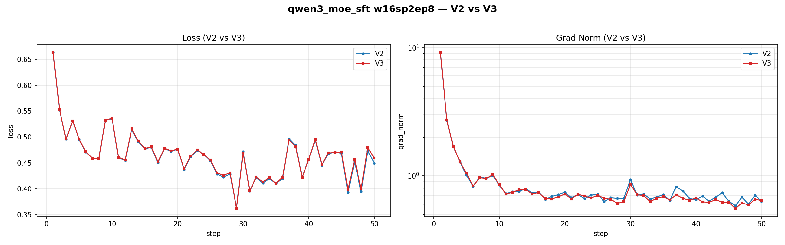

# Qwen3 MoE

## 运行脚本

`scripts/runs/lf_qwen3_moe_sft.sh`

## AIStudio 环境

```python
import os
from pypai.job import PythonJobBuilder
from pypai.conf import ExecConf
from pypai.conf import KMConf
from pypai.conf import GpuType
from pypai.conf import AlertConf
from aistudio_common.openapi.models import DataStore

def update_pypai():
    # install dependencies
    import subprocess
    try:
        subprocess.run(["pip", "install", "--upgrade", "aii-pypai"], check=True)
        print("pip executes succeeded!")
    except subprocess.CalledProcessError as e:
        print(f"pip executes failed with code {e.returncode}")

def torch_train():
    update_pypai()
    a3_sfs_old = DataStore(mount_point="/sfs_turbo", store_name="wl02-antfinix-sfs")
    a3_sfs_new = DataStore(mount_point="/mnt/sfs_turbo", store_name="wl02-aicompiler-sfs")
    km_conf = KMConf(
        image="hcr.meta-wulan01.hw-wulan.local/aii/aistudio:15100125-20251212112959_aarch64"
    )

    labels={
        "\"sigma.ali/rack-group-num\"":"1",
    }
    edl_job_args = "--critical_worker_index=0:2 --relaunch_always=false --relaunch_count 0"

    annotations = {
        "ELASTICDL_MASTER_CONFIGURATION": '{"cpu": 4, "memory": 2048, "image":"hcr.meta-wulan01.hw-wulan.local/kubemaker/elasticdl:test-aarch64-bc4298b59706f305893044af221fa99880ae2210"}'
    }

    node_gpu_num = 16
    node_num = 1

    command = ''
    command += 'conda env list && conda init && source /root/.bashrc && conda activate sftenv && conda info --envs && '
    command += f'export NPUS_PER_NODE={node_gpu_num} && export NNODES={node_num} && '
    command += "pip list && source /usr/local/Ascend/ascend-toolkit/set_env.sh && echo 'cannVersion: ', $ASCEND_TOOLKIT_HOME && \
        pip install pynvml --trusted-host repo.huaweicloud.com && \
        wget  https://gpu-wulanchabu-aistudiocode.oss-cn-wulanchabu.aliyuncs.com/040846/dlrover-0.6.0rc730-py3-none-any.whl && \
        pip install dlrover-0.6.0rc730-py3-none-any.whl --trusted-host repo.huaweicloud.com && \
        pip install grpcio --trusted-host repo.huaweicloud.com && \
        cd /sfs_turbo/zlj/LLaMA-Factory && \
        pip install -r requirements.txt && \
        pip install deepspeed==0.16.0 && \
        pip install transformers==4.57.3 && \
        ls /home/ma-user/anaconda3/envs/ && \
        pip list && "

    command += ' sleep inf'
    name = 'qwen3_moe_env'

    master= ExecConf(cpu=256, memory=2000000, gpu_num=node_gpu_num, num=1, shared_memory=20480, gpu_type="hpu910c", disk_m=192000)
    worker = ExecConf(cpu=256, memory=2000000, gpu_num=node_gpu_num, num=node_num-1, shared_memory=20480, gpu_type="hpu910c", disk_m=192000)
    # worker = ExecConf(cpu=256, memory=2000000, gpu_num=node_gpu_num, num=node_num, shared_memory=20480, gpu_type="hpu910c", disk_m=192000)
    job = PythonJobBuilder(# source_root="./",
                           main_file="", #命令模式必填空，详情参考：https://yuque.antfin-inc.com/aii/aistudio/gpu-job#y3tRY
                           km_conf=km_conf,
                           command=command,
                           platform="kubemaker",
                           k8s_app_name="hpuopt",
                           k8s_priority="high",
                           distribution_strategy="AllreduceStrategy",
                           master=master,
                           worker=worker,
                           runtime="pytorch",
                           name=name,
                           tag="type=SFT,basemodel=ling25",
                           data_stores = [a3_sfs_old, a3_sfs_new],
                           host_network=False,
                           labels=labels,
                           edl_job_args = edl_job_args,)
                          #  annotations=annotations,

    job.run()

if __name__ == "__main__":
    torch_train()
```

## 运行方式

```bash
conda activate sftenv
sh scripts/runs/lf_qwen3_moe_sft.sh
```

## torchturbo v2 对比


